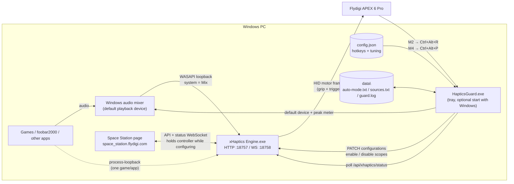
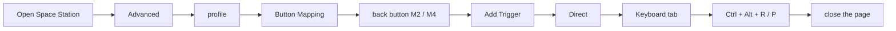
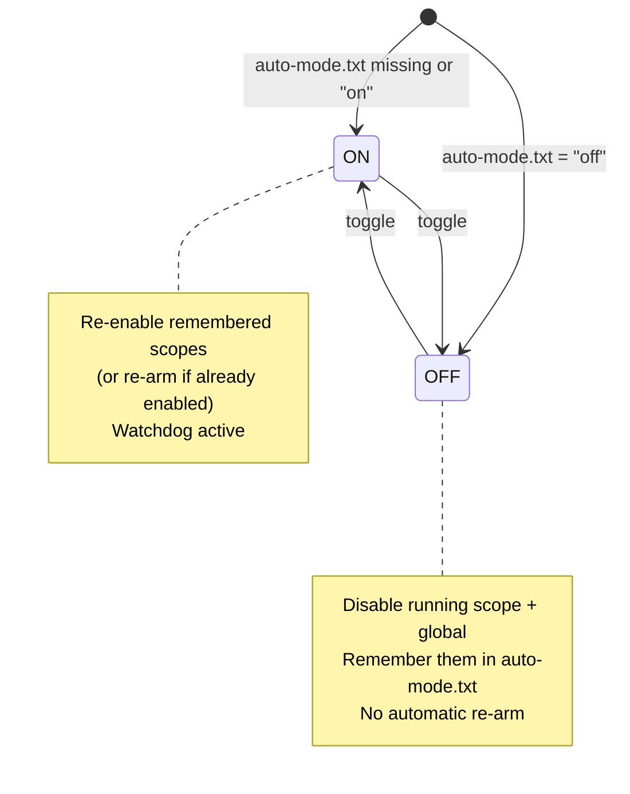
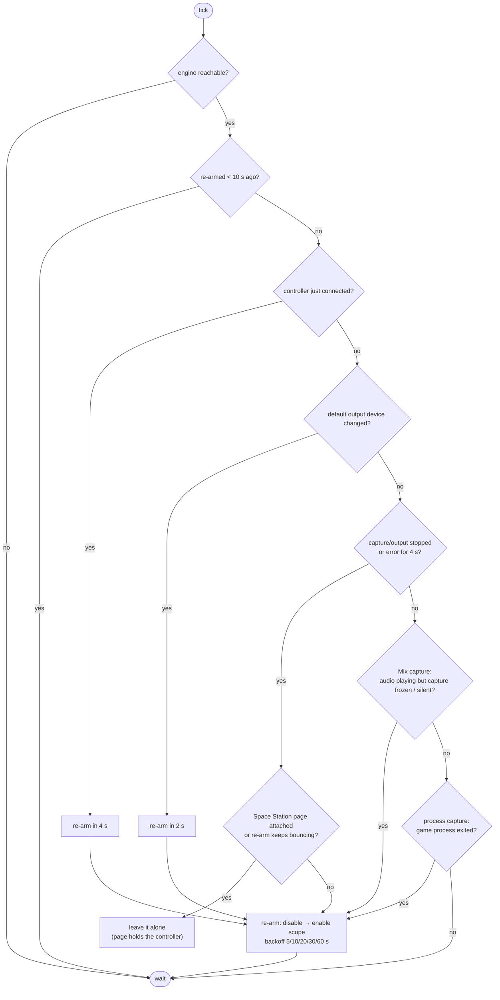
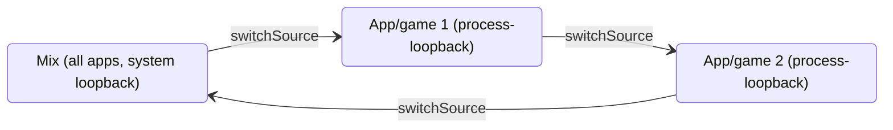
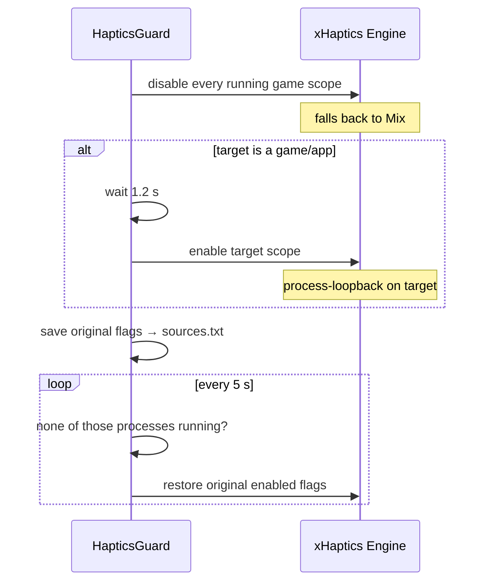

# X-Haptics Guard — diagrams

## 1. Components

## 1b. Mapping a back button to a hotkey (Space Station)

Screenshots: see README › *Mapping the APEX back buttons*.

## 2. Master switch — toggle hotkey (default Ctrl+Alt+R, M2)

## 3. Watchdog (only while ON, every pollMs)

## 4. Audio source — switchSource hotkey (default Ctrl+Alt+P, M4)

Candidates = games/apps registered in X-Haptics (built-in or custom) whose process is running, sorted by name.

