# X-Haptics Guard

A small Windows tray tool for the **Flydigi APEX 6 Pro** (and other controllers driven by the Flydigi
*xHaptics Engine*). It fixes the "X-Haptics stopped vibrating, go to the web page and toggle it" problem
and lets you control X-Haptics from the controller's back buttons:

| Default hotkey | Suggested button | What it does |
|---|---|---|
| `Ctrl+Alt+R` | M2 | **Master switch.** OFF = X-Haptics disabled and nothing turns it back on. ON = X-Haptics enabled and the watchdog keeps it alive. |
| `Ctrl+Alt+P` | M4 | **Switch audio source.** Mix (all apps) → app/game 1 → app/game 2 → … → Mix. |
| *(none)* | – | Re-arm X-Haptics once (disable → enable) without changing the master switch. |

All hotkeys are configurable in `config.json`.

See [DIAGRAM.md](DIAGRAM.md) for how the pieces fit together.

---

## How it works

The xHaptics Engine (`C:\Program Files\Flydigi\Engine\xHaptics Engine.exe`) runs a local HTTP API on
`127.0.0.1:18757`. The Space Station web page (`space_station.flydigi.com`) talks to that API. The engine:

1. captures audio with WASAPI loopback: the whole system mix by default, or a single process
   (process-loopback) while an enabled game/app profile is running,
2. turns it into grip/trigger motor frames,
3. sends them to the controller over HID.

The "toggle X-Haptics" switch on the web page is just
`PATCH /api/v1/xhaptics/configurations/{scope}` with `enabled: false` then `true`, which rebuilds the
capture pipeline. X-Haptics Guard calls the same API and authenticates the same way the web page does.

### Watchdog (while the master switch is ON)

X-Haptics is re-armed automatically when:

- the controller (re)connects,
- the Windows default playback device changes,
- the engine reports that capture or output stopped, or reports an error (for example after a player
  released WASAPI exclusive mode),
- audio is playing but the engine's system capture is frozen or only hears silence,
- a per-game capture is still bound to a game process that has already exited.

Repeated re-arms back off (5 → 10 → 20 → 30 → 60 s). The watchdog **never fights the Space Station
page**: while that page is open and holds the controller (button mapping, firmware update…), the engine
pauses X-Haptics on purpose and the guard leaves it alone. Close the page to resume.

> X-Haptics has its own *Real-time audio auto sleep*: with no controller input it stops vibrating until
> you press a button. That is not a fault, and the guard does not treat it as one.

### Audio source switching

The engine has no "capture this process" call. Instead it captures one process while an **enabled**
game/app profile is running, and the whole mix when none is. The switch-source hotkey flips the
`enabled` flags of the running profiles:

- **Mix**: every running profile disabled, so the engine captures all apps.
- **App/game X**: only X enabled, so the engine captures only X.

Only apps/games that are **registered in X-Haptics, currently running and not excluded** are in the
cycle. Manage them from the tray menu **Audio sources**. It lists every process that has an audio
session (the same apps the Windows volume mixer shows) plus running registered games:

- **Checked** = part of the cycle.
- Checking an app marked *not registered* registers it as an X-Haptics custom game with its profile
  **off** (`POST /api/v1/xhaptics/games/custom`). While the profile is off the engine ignores the app,
  and the switch-source hotkey turns it on only when you select it.
- Unchecking adds the process to `sources.exclude` in `config.json`. Nothing is removed from Flydigi's
  game list. An excluded game is never picked as a target, but it is still switched off when you
  select Mix or another source.

You can also register apps by hand in Space Station → X-Haptics → add a custom game. Turn the new
profile off there.

#### Multi-process apps (Chrome, Edge, other Chromium/Electron apps)

Chrome has dozens of `chrome.exe` processes. Audio comes from a child *audio service* process. The
engine's process-loopback includes the whole process tree of the process it captures, and it chooses
that process continuously:

- **while the app's window is focused**: the process that owns that window (Chrome's main browser
  process, whose tree contains the audio service), so haptics work;
- **otherwise**: the process it matched by name when the profile started, often a renderer that plays
  nothing, so the capture is silent.

Re-arming the profile does not change this, because the engine matches a renderer again. The guard can
only detect it: after switching to such a source, if the captured process tree plays nothing while
another process of the same app does, a balloon says so and the log shows
`… plays no audio (multi-process app; only captured while its window is focused)`.

In practice, browsers work as a per-app source only while you are in the browser window. For browser
audio in the background, use Mix. Single-process players (foobar2000…) and games are not affected.

The original `enabled` flags are saved in `data\sources.txt` and put back once those processes have
exited, so the next game launch behaves as before.

WASAPI **exclusive** mode bypasses the Windows mixer, so nothing (not even the engine) can capture that
audio. Use WASAPI *shared* if you want haptics from a music player.

---

## Requirements

- Windows 10/11 with .NET Framework 4.x (built in; no SDK needed).
- Flydigi xHaptics Engine installed and running (it starts with Windows by default).

## Build and install

```bat
build.cmd              :: compiles HapticsGuard.exe with the csc.exe that ships with Windows
HapticsGuard.exe       :: run it; it sits in the tray (only one instance runs)
```

The guard does **not** start with Windows by itself. Turn that on or off from the tray menu with
**Start with Windows**, which adds or removes `X-Haptics Guard` under
`HKCU\Software\Microsoft\Windows\CurrentVersion\Run`. A Startup-folder shortcut from older versions
counts as "on" and is removed the next time you use the toggle.

The folder is self-contained, so you can copy or clone it anywhere:

| Path | Tracked in git | Purpose |
|---|---|---|
| `HapticsGuard.cs` | yes | source |
| `build.cmd` | yes | build script |
| `config/config.default.json` | yes | default settings; copied to `config.json` on first run and by tray › *Reset config to defaults* |
| `config.json` | no | your hotkeys and tuning (edited by you and by the *Audio sources* menu) |
| `README.md`, `DIAGRAM.md` | yes | docs |
| `docs/images/*.png` | yes | annotated Space Station screenshots used in this README |
| `HapticsGuard.exe` | no | build output |
| `data\auto-mode.txt` | no | master switch state + scopes it disabled |
| `data\sources.txt` | no | original profile flags changed by source switching |
| `data\guard.log` | no | log (rotated at 1 MB) |

## Tray menu

- **X-Haptics on + auto re-arm**: the master switch (check mark = ON).
- **Switch audio source**
- **Audio sources**: choose which apps are part of the switch-source cycle (see above).
- **Re-arm X-Haptics once**
- **Open X-Haptics settings**: opens the Space Station X-Haptics page (as a Chrome app window if Chrome is installed).
- **Edit config** / **Reload config**: edit `config.json`, then reload without restarting.
- **Reset config to defaults...**: after a confirmation, overwrites `config.json` with `config/config.default.json` and
  reloads. The previous file is saved as `data\config.backup.json`. Use this when the file is broken
  (a balloon says `config.json error` on start or reload).
- **View log**
- **Start with Windows**: on/off, off by default.
- **Start xHaptics Engine**: only shown when the engine is installed but not running.
- **Exit**

The tooltip shows `[ON]` / `[OFF]` and the last action.

## Command line

```bat
HapticsGuard.exe            :: start (only one instance runs)
HapticsGuard.exe --toggle   :: master switch
HapticsGuard.exe --cycle    :: switch audio source
HapticsGuard.exe --kick     :: re-arm once
HapticsGuard.exe --reload   :: reload config.json
```

## Configuration (`config.json`)

```json
{
  "hotkeys": {
    "toggle": "Ctrl+Alt+R",
    "switchSource": "Ctrl+Alt+P",
    "rearmOnce": ""
  },
  "engine": {
    "apiUrl": "http://127.0.0.1:18757",
    "webOrigin": "https://space_station.flydigi.com",
    "statusSocketPort": 18758,
    "exePath": "C:\\Program Files\\Flydigi\\Engine\\xHaptics Engine.exe",
    "gameListPath": "%APPDATA%\\Flydigi\\xHaptics Engine\\config\\xhaptics_game_status.json"
  },
  "ui": {
    "url": "https://space_station.flydigi.com/#/controller/x-haptics",
    "browser": ""
  },
  "watchdog": { "...": "see below" },
  "sources": {
    "exclude": ["steam.exe"]
  }
}
```

- **sources.exclude**: process names never picked by the switch-source cycle. The *Audio sources* menu
  keeps this list up to date (it rewrites only this key, keeping the rest of the file).

- **Hotkeys**: defaults are `Ctrl+Alt+R` and `Ctrl+Alt+P`, picked because few apps use them (`Ctrl+Alt+S`, for example, is a window zoom shortcut in some tools). Format: modifiers `Ctrl`, `Alt`, `Shift`, `Win` plus one key name from .NET `Keys` (`A`–`Z`,
  `0`–`9`, `F1`–`F24`, `Home`, `PageUp`, `OemPeriod` for `.`/`>`, `Oemcomma` for `,`/`<`, …). An empty string disables the hotkey. If another app
  already owns a hotkey, a balloon and the log say so.
- **engine.exePath**: used only for the tray icon.
- **engine.gameListPath**: the engine's own list of games and their process names. The guard reads this
  file instead of calling `GET /api/v1/xhaptics/games`, because that call makes the engine rescan games
  and drop to Mix for about 2 seconds. The API is only used as a fallback when you switch the source
  yourself and the file cannot be read.
- **ui.browser**: empty = Chrome app window if Chrome is installed, otherwise the default browser.
  You can also give a full path to a browser exe.
- **watchdog**:

| Key | Default | Meaning |
|---|---|---|
| `pollMs` | 1000 | status poll interval |
| `reconnectDelaySec` | 4 | re-arm this long after the controller connects |
| `deviceChangeDelaySec` | 2 | re-arm this long after the default output device changes |
| `brokenPersistSec` | 4 | how long "stopped/error" must last before a re-arm |
| `rearmGraceSec` | 10 | ignore "stopped" this long after any re-arm or source switch |
| `stallSec`, `stallAudioSec` | 5, 3 | capture frozen this long while audio plays this long |
| `audioPeakThreshold` | 0.02 | system meter level that counts as "audio is playing" |
| `loudPeakThreshold`, `engineSilentPeak`, `silentMismatchKick` | 0.05, 0.0005, 6 | "loud system audio but the engine hears silence" detector |
| `healthyResetSec` | 30 | reset the backoff after this long healthy |
| `maxIdleBounces` | 2 | re-arms undone by someone else before the guard stops retrying |
| `webCheckDelaySec` | 5 | after a manual re-arm, check whether the Space Station page paused it |
| `backoffSec` | [5,10,20,30,60] | wait between automatic re-arms |

After editing, use **Reload config** (or `--reload`).

---

## Mapping the APEX back buttons (M1–M4) to the hotkeys

Keyboard output is only available in **Advanced** mapping mode. The *Basic* mode only offers
Controller / Combo / Media / Turbo / Macro targets.

| Back button | Hotkey (default) | Action |
|---|---|---|
| M2 | `Ctrl+Alt+R` | master switch (X-Haptics on/off + watchdog) |
| M4 | `Ctrl+Alt+P` | switch audio source |
| *(free)* | set `rearmOnce` in `config.json` | re-arm once |

```mermaid
flowchart LR
    A["Open Space Station<br/>(tray › Open X-Haptics settings)"] --> B["① Advanced"]
    B --> C["② pick your profile"]
    C --> D["③ Button Mapping"]
    D --> E["④ click a back button<br/>(M2 / M4)"]
    E --> F["⑤ Add Trigger<br/>(trigger list opens)"]
    F --> G["⑥ Direct"]
    G --> H["⑦ Keyboard tab"]
    H --> I["⑧ Ctrl + Alt"]
    I --> J["⑨ key: R (M2) / P (M4)"]
    J --> K["repeat for each profile<br/>you use"]
    K --> L["close the Space Station page"]
    L --> M["press the button<br/>tray › View log"]
```



### Step 1: pick the button and the trigger type (①–⑥)


1. **Advanced**: switch the top-left toggle from *Basic* to *Advanced*.
2. **Profile**: select the profile you use (Profile 1–4 on the left). Mappings are per profile.
3. **Button Mapping** tab.
4. **Back button**: click the button under *Rear Buttons*. Both screenshots show **M2** (master switch,
   `Ctrl+Alt+R`); do the same for **M4** with `Ctrl+Alt+P`.
5. **Add Trigger** in the *Trigger Actions* panel on the right. The list of trigger types opens first.
6. **Direct**: click it. The action picker (steps 7–9) only appears after you choose a trigger type.
   - **Direct** fires as soon as you press. This is what the screenshots use.
   - **Long Press** also works if you want to hold the button, so a slip of the finger does not turn haptics off.
   - Avoid **Press Pulse** / **Release Pulse**: the pulse can be too short for Windows to register the
     key combination.

### Step 2: choose the key combination (⑦–⑨)


7. **Keyboard** tab of the action picker.
8. **Combo Modifiers**: turn on **Ctrl** and **Alt**.
9. **Key**: **R** for M2, **P** for M4. The trigger row then reads `Direct → Ctrl+Alt+R`, and the back
   button shows `Ctrl+A…`.

If a *keyboard/mouse compatibility* notice appears, choose **Continue mapping**. Pressing the button only
sends a hotkey, so games are not affected. If your Space Station version has a Save/Apply button, press it.
Repeat for every profile you use, then **close the Space Station page**: while it is open it holds the
controller and X-Haptics stays paused.

Check that it works: press the button, then open tray → **View log**. You should see `switch ON/OFF` or
`audio source -> …`. If nothing shows up, the button is not sending the hotkey: check the profile, or
whether another app grabbed the combination (`hotkey warning` in the log).

Notes:

- The mapped back button no longer acts as a controller button in games.
- Re-arming resets X-Haptics' auto-sleep gate. A keyboard hotkey does not wake it, so press any controller button afterwards.

---

## Troubleshooting

| Log line / symptom | Meaning / fix |
|---|---|
| `config.json error: …` | The file is not valid JSON. Fix it and *Reload config*, or use *Reset config to defaults...*. |
| `engine idle while Space Station page is attached` | The Space Station page holds the controller. Close it. |
| `engine unreachable` | The xHaptics Engine is not running (or still starting). The guard keeps polling and starts monitoring as soon as the engine answers; nothing is shown at startup. If you press a hotkey meanwhile, a balloon says whether the engine is **not installed**, **not running** (tray > *Start xHaptics Engine*) or **not responding**. |
| `hotkey warning: … already used by another app` | Pick another combination in `config.json` and remap the button. |
| No vibration but `session=Running` | Auto-sleep: press any controller button. Also check the controller battery. |
| A game's profile stays off | It was disabled by source switching and the game is still running. Cycle back, or exit the game and the original flags are restored automatically. |

The engine's local API is undocumented and may change with Flydigi updates; if a new engine version
breaks something, the log will show `re-arm failed` / `switch failed` with the HTTP error.

## License

[MIT](LICENSE) © 2026 Emrise. Not affiliated with Flydigi; "Flydigi", "APEX" and "X-Haptics" belong to
their owners.
