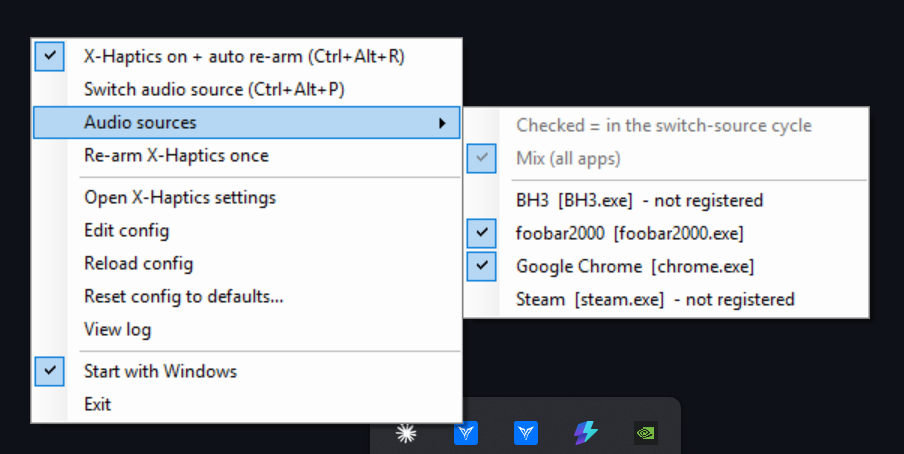
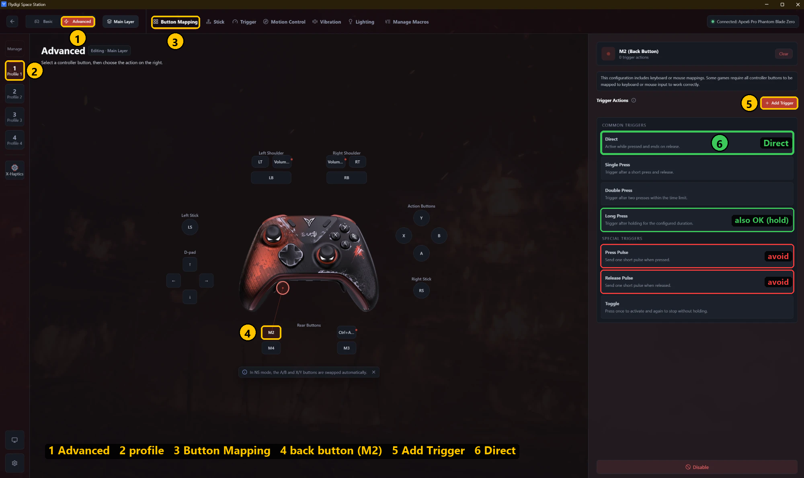
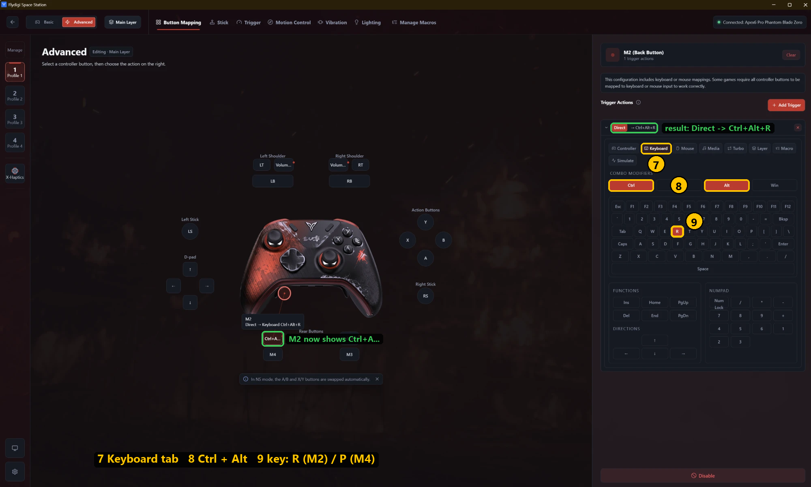

# X-Haptics Guard

A small Windows tray tool for the **Flydigi APEX 6 Pro** (and other controllers driven by the Flydigi
*xHaptics Engine*). It fixes the "X-Haptics stopped vibrating, go to the web page and toggle it" problem
and lets you control X-Haptics from the controller's back buttons:

| Default hotkey | Suggested button | What it does |
|---|---|---|
| `Ctrl+Alt+R` | M2 | **Master switch.** OFF = X-Haptics disabled and nothing turns it back on. ON = X-Haptics enabled and the watchdog keeps it alive. |
| `Ctrl+Alt+P` | M4 | **Switch audio source.** Mix (all apps) → app/game 1 → app/game 2 → … → Mix. |
| *(none)* | – | Re-arm X-Haptics once (disable → enable) without changing the master switch. |

**Download:** [latest release](https://github.com/Emrise-r/flydigi-xhaptic-controller/releases/latest)
([v1.0.2](https://github.com/Emrise-r/flydigi-xhaptic-controller/releases/tag/v1.0.2)). Get
`HapticsGuard-v1.0.2.zip`, extract it anywhere and run `HapticsGuard.exe`.

> **Requires the Flydigi xHaptics Engine.** This tool only drives the engine's local API; it does not
> make the controller vibrate by itself. Install the engine with Flydigi Space Station first.
>
> **Tested on:** Flydigi APEX 6 Pro *Phantom Blade Zero* edition, xHaptics Engine 5.0.1.6, Windows 11.
> Other Flydigi controllers that use the same engine may work but are untested.

### Documentation

| | |
|---|---|
| [docs/HOW-IT-WORKS.md](docs/HOW-IT-WORKS.md) | engine API, watchdog rules and delays, source switching, follow child audio, controller states |
| [docs/CONFIGURATION.md](docs/CONFIGURATION.md) | every `config.json` setting |
| [docs/TESTING.md](docs/TESTING.md) | manual test cases and what was measured (controller/dock, Chrome, BH3, antivirus scans) |
| [docs/DEVELOPMENT.md](docs/DEVELOPMENT.md) | build, source layout, files, release checklist |
| [DIAGRAM.md](DIAGRAM.md) | diagrams |

---

## Requirements

- **Flydigi xHaptics Engine**, installed and running (its installer starts it with Windows). If it is
  missing or stopped, the guard says so when you press a hotkey, and the tray menu offers
  *Start xHaptics Engine*.
- Windows 10/11 with .NET Framework 4.x (built in).

## Install

Only `HapticsGuard.exe` is needed. On first start it creates `config.json` and `data\` (log and state)
next to the exe, or in `%LOCALAPPDATA%\FlydigiHapticsGuard\` when that folder is not writable.

| Put it in | |
|---|---|
| `%LOCALAPPDATA%\Programs\X-Haptics Guard\` | recommended per-user location, no admin needed |
| any folder you created, Desktop, Downloads | fine |
| `C:\Program Files\…` | works; settings and log go to `%LOCALAPPDATA%\FlydigiHapticsGuard\`. Do not run it as administrator |

The guard does **not** start with Windows by itself: turn **Start with Windows** on in the tray menu.

To build it yourself: run `build.cmd` (uses the C# compiler that ships with Windows), see
[DEVELOPMENT.md](docs/DEVELOPMENT.md).

**Antivirus:** the exe is small, unsigned, registers global hotkeys and lists processes, so a few engines
flag it with generic machine-learning verdicts (v1.0.2: Defender clean,
[VirusTotal](https://www.virustotal.com/gui/file/23563875530c5f8794c28058c487a36a349a22ec7aab574d766ec6477e70b289)
5/69, major engines clean). Build it from source if you prefer.

---

## Mapping the APEX back buttons (M1–M4) to the hotkeys

Keyboard output is only available in **Advanced** mapping mode.

| Back button | Hotkey (default) | Action |
|---|---|---|
| M2 | `Ctrl+Alt+R` | master switch (X-Haptics on/off + watchdog) |
| M4 | `Ctrl+Alt+P` | switch audio source |
| *(free)* | set `rearmOnce` in `config.json` | re-arm once |

```mermaid
flowchart LR
    A["Open Space Station<br/>(tray › Open X-Haptics settings)"] --> B["① Advanced"]
    B --> C["② pick your profile"]
    C --> D["③ Button Mapping"]
    D --> E["④ click a back button<br/>(M2 / M4)"]
    E --> F["⑤ Add Trigger<br/>(trigger list opens)"]
    F --> G["⑥ Direct"]
    G --> H["⑦ Keyboard tab"]
    H --> I["⑧ Ctrl + Alt"]
    I --> J["⑨ key: R (M2) / P (M4)"]
    J --> K["repeat for each profile<br/>you use"]
    K --> L["close the Space Station page"]
    L --> M["press the button<br/>tray › View log"]
```

### Step 1: pick the button and the trigger type (①–⑥)

1. **Advanced**: switch the top-left toggle from *Basic* to *Advanced*.
2. **Profile**: select the profile you use. Mappings are per profile.
3. **Button Mapping** tab.
4. **Back button**: click it under *Rear Buttons*. The screenshots show **M2** (`Ctrl+Alt+R`); do the
   same for **M4** with `Ctrl+Alt+P`.
5. **Add Trigger**: the list of trigger types opens first.
6. **Direct**. **Long Press** also works if you prefer holding the button. Avoid **Press Pulse** /
   **Release Pulse**: the pulse can be too short for Windows to register the combination.

### Step 2: choose the key combination (⑦–⑨)

7. **Keyboard** tab.
8. **Combo Modifiers**: turn on **Ctrl** and **Alt**.
9. **Key**: **R** for M2, **P** for M4. The trigger row reads `Direct → Ctrl+Alt+R`.

If a *keyboard/mouse compatibility* notice appears, choose **Continue mapping**. Repeat for every
profile you use, then **close the Space Station page**: while it is open it holds the controller and
X-Haptics stays paused. Press the button and check tray › **View log** for `switch ON/OFF` or
`audio source -> …`.

The mapped button no longer acts as a controller button in games.

---

## Tray menu

- **Source / Controller**: what is being captured (an app, `Mix (all apps)`, `X-Haptics off`, …) and
  the controller state (`connected`, battery, `haptics asleep`, `not connected`).
- **X-Haptics on + auto re-arm**: the master switch.
- **Switch audio source** / **Audio sources**: cycle the source, choose which apps are in the cycle.
  Apps that run inside a game are listed under it, e.g. `↳ ZFGameBrowser (in BH3)`.
- **Re-arm X-Haptics once**, **Open X-Haptics settings**
- **Edit config**, **Reload config**, **Reset config to defaults...**, **View log**
- **Start with Windows** (off by default), **Start xHaptics Engine** (only when the engine is not running), **Exit**

Command line: `HapticsGuard.exe --toggle | --cycle | --kick | --reload`.

## Good to know

- **Re-arming interrupts haptics for 1–2 s** and Flydigi shows a "configuration applied" popup.
- **Haptics fall asleep** after a while without controller input (Space Station's *Real-time audio auto
  sleep*) and after every re-arm. Press any controller button; the back-button hotkeys do not wake them.
- **The Space Station page pauses X-Haptics** while it is open. Close it when you are done.
- **Turned off in Space Station?** The guard leaves it off and says so; press the master switch twice.
- **Browsers** (Chrome, Edge…) only work as a per-app source while their window is focused; use Mix.
- **Games with embedded browsers** (BH3 web events): the guard follows the child process automatically.
- **WASAPI exclusive** players bypass Windows' mixer; nothing can capture them. Use *shared* mode.
- **Controller off / dock / cable**: the guard shows one balloon per state change, e.g.
  *Controller disconnected… Press Home to reconnect*.

Details: [HOW-IT-WORKS.md](docs/HOW-IT-WORKS.md).

## Troubleshooting

| Log line / symptom | Meaning / fix |
|---|---|
| `config.json error: …` | Invalid JSON. Fix it and *Reload config*, or *Reset config to defaults...*. |
| `engine idle while Space Station page is attached` | The Space Station page holds the controller. Close it. |
| `engine unreachable` | The engine is not running or still starting; the guard waits for it. A hotkey press tells you whether it is not installed, not running or not responding. |
| `hotkey warning: … already used by another app` | Pick another combination in `config.json` and remap the button. |
| No vibration but the source looks right | Haptics asleep: press any controller button. Check the battery. |
| A game's profile stays off | Source switching disabled it while the game runs. Cycle back, or exit the game; the original flags are restored automatically. |
| `re-arm failed` / `switch failed` with an HTTP error | A Flydigi update may have changed the engine API. |

## License

[MIT](LICENSE) © 2026 Emrise. Not affiliated with Flydigi; "Flydigi", "APEX" and "X-Haptics" belong to
their owners.
